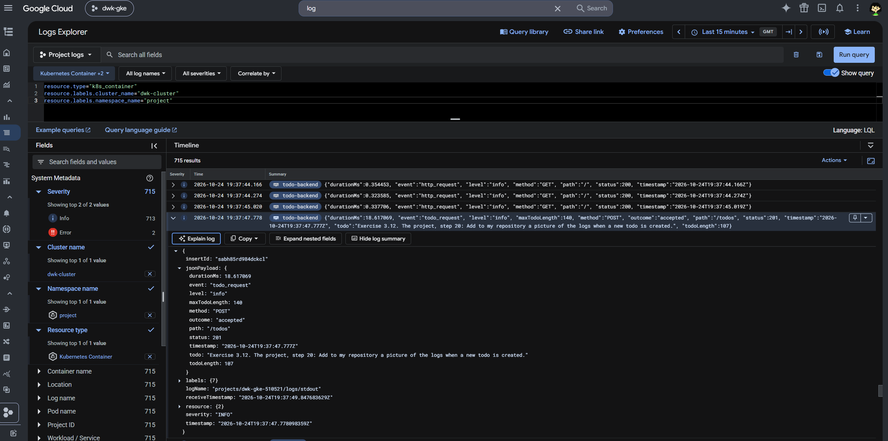

## The Project

- The form sends new todos (limited to 140 characters) to the Todo Backend service.
- The list of todos is fetched from the Todo Backend service.
- The random image is persistently cached.
- The shutdown buttons exit either the Todo App or Todo Backend process so K8s restarts the selected container. The cached image and PostgreSQL-backed todos persist across application restarts.

### Deployment

The [Release application workflow](../.github/workflows/main.yml) creates the cluster, builds and publishes The Project and the todo backend.

Wait for the workflow to finish, then find the ingress address:

```sh
kubectl -n project get ingress --watch
```

The app should be available at http://<INGRESS_ADDRESS>/ once the IP address is assigned.

### Endpoints

- `GET /` — displays the todo application.
- `GET /image` — serves the persistently cached Lorem Picsum image.
- `POST /shutdown` — shuts down the Node process so Kubernetes can restart the container.

- `GET /todos` returns the list of todos as JSON.
- `POST /todos` accepts `{ "todo": "Learn Kubernetes" }` and creates a todo.
- `POST /todos/shutdown` shuts down the process so Kubernetes can restart the container.

### Todo creation logs in GKE



### Daily DB backups

The backup CronJob uses `pg_dump` to write a plain SQL dump into a shared temporary volume. Once the dump succeeds, the upload container sends the completed file to Cloud Storage with `gcloud storage cp`. A failed dump prevents the upload container from starting.

#### GCP one-time setup

1. Deploy through the `Release application` workflow first. Then:

```sh
PROJECT_ID="<PROJECT_ID>"
BUCKET_NAME="${PROJECT_ID}-todo-backups"
NAMESPACE="project"
PROJECT_NUMBER="$(gcloud projects describe "$PROJECT_ID" --format='value(projectNumber)')"

gcloud container clusters get-credentials dwk-cluster \
  --zone=europe-west1-b --project="$PROJECT_ID"
```

2. Create the bucket and grant access to the backup ServiceAccount in the selected namespace:

```sh
gcloud storage buckets create "gs://$BUCKET_NAME" \
  --project="$PROJECT_ID" --location=europe-west1 \
  --uniform-bucket-level-access

BACKUP_PRINCIPAL="principal://iam.googleapis.com/projects/${PROJECT_NUMBER}/locations/global/workloadIdentityPools/${PROJECT_ID}.svc.id.goog/subject/ns/${NAMESPACE}/sa/todo-db-backup"

for BACKUP_ROLE in roles/storage.objectCreator roles/storage.objectViewer; do
  gcloud storage buckets add-iam-policy-binding "gs://$BUCKET_NAME" \
    --member="$BACKUP_PRINCIPAL" --role="$BACKUP_ROLE" --condition=None
done
```

Main uses `project`. For another branch environment, set `NAMESPACE` to its namespace and repeat the IAM grants.

#### Test backup

Start a Job from the CronJob to check the setup:

```sh
JOB_NAME="todo-db-backup-manual-$(date -u +%Y%m%d%H%M%S)"
kubectl -n "$NAMESPACE" create job "$JOB_NAME" --from=cronjob/todo-db-backup
kubectl -n "$NAMESPACE" wait --for=condition=complete "job/$JOB_NAME" --timeout=10m
kubectl -n "$NAMESPACE" logs "job/$JOB_NAME" -c upload
gcloud storage ls "gs://$BUCKET_NAME/$NAMESPACE/"
```

### DBaaS vs DIY

#### Setup and maintenance

##### Initial setup

- Cloud SQL: You have to create an instance, choose its capacity and region, create the database and users, and configure backups and availability. Connecting GKE also requires network access and authentication config.

- DIY: Configure the image, StatefulSet, Service, credentials (Secrets), PV and PVC. Monitoring, backups and recovery would need implementation as well.

##### Maintenance

- Cloud SQL: Google takes care of OS and DB maintenance updates, but you'll still have to manage access, schema migrations, query performance, capacity and alerts. [Maintenance can interrupt connections](https://docs.cloud.google.com/sql/docs/postgres/shared-responsibility), so it needs planning.

- DIY: You maintain the PostgreSQL image, apply security fixes, plan upgrades, monitor the database, expand storage and troubleshoot failures. So this requires more time and expertise.

##### Availability

- Cloud SQL: Regional HA provides a standby in another zone and managed failover.

- DIY: Single replica has downtime while its Pod or node recovers. The PVC preserves data across Pod restarts, but does not provide database failover. Simply increasing StatefulSet replicas does not configure replication, so HA requires PostgreSQL replication, failure detection and promotion, plus additional compute and storage. 

##### Control and portability

- Cloud SQL: Less infrastructure to operate.

- DIY: More control over versions, extensions, configuration and backup tooling. K8s manifests can be reused elsewhere, but moving the database still requires transferring data and adapting storage and networking.

#### Costs

Neither option requires buying hardware upfront. The initial cost is setup time and the cloud resources provisioned during setup.

- Cloud SQL (higher):
    + Database compute charges even when the application is idle.
    + Provisioned storage and backup storage.
    + Network charges.
    + HA adds compute and storage charges.
- DIY (lower):
    + GKE compute, Persistent Disks, backup storage and network traffic cost money.
    + Maintenance, incident response and restore testing also have a labor cost.
    + A small basic DB is low cost, but if we need larger or additional nodes, that saving decreases.

#### Backup methods and ease of recovery

- Cloud SQL:
    + Supports scheduled and on-demand backups with configurable retention.
    + Google manages their creation and storage and you only configure the policy, checks results and tests restores.
    + Restores are available through the console or CLI, making routine recovery easier to operate.

- DIY (PostgreSQL):
    + Logical dumps: schedule `pg_dump` with a CronJob and upload the result to storage outside the cluster, such as Cloud Storage.
        * A dump provides a consistent database snapshot while the database remains available.
        * You can restore a custom-format dump with `pg_restore`, or with a plain SQL dump with `psql`.
        * It's straightforward for a small database and portable between PostgreSQL installations, but recovery loses changes since the last successful dump and can be slow for large databases.
    + Volume snapshots: GKE supports [CSI volume snapshots](https://docs.cloud.google.com/kubernetes-engine/docs/how-to/persistent-volumes/volume-snapshots), which can be restored into a PVC. PostgreSQL data  must be captured consistently.
